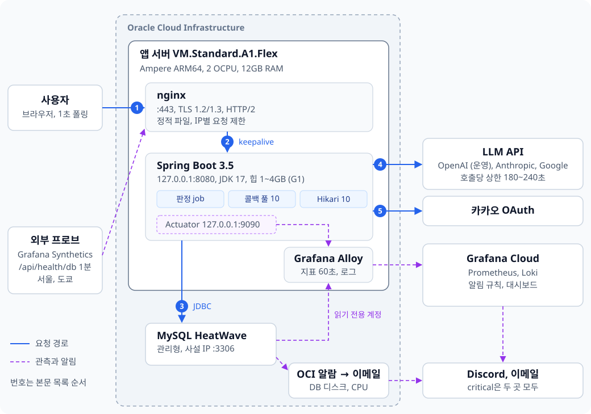

# 사이브리핑

https://saibriefing.com

이별한 사람이 사연을 쓰면 재회 가능성을 판정해 주는 웹 서비스입니다. 몇 가지 질문에 답하고 글을 하나 쓰면 판정 글 한 편과 네 단계 등급이 나옵니다. 로그인 없이 쓸 수 있습니다.

판정 한 번에 LLM 응답을 2~3분 기다리고, 호출마다 돈이 나갑니다. 그래서 이 저장소에서 가장 공들인 곳은 세 군데입니다. 느린 LLM을 기다리는 동안 서버 자원을 잡지 않는 것, 결제가 끊기거나 겹쳐도 돈과 이용권이 어긋나지 않는 것, 반복 호출과 버그가 LLM 비용을 태우지 못하게 막는 것입니다. 전부 OCI ARM 서버 한 대에서 돕니다.

<!-- 직접 채울 곳: 판정 화면 캡처 한 장 -->

## Architecture

<picture>
  <source media="(prefers-color-scheme: dark)" srcset="readme-images/architecture-dark.svg">
  
</picture>

1. **브라우저 → nginx**: TLS를 끝내고 정적 파일을 바로 내줍니다. 요청 횟수 제한도 여기서 IP별로 겁니다.
2. **nginx → Spring Boot**: 앱은 127.0.0.1:8080에만 붙어 있고, nginx가 keepalive 커넥션으로 프록시합니다.
3. **Spring Boot → MySQL HeatWave**: 사설 IP로만 붙는 관리형 DB입니다.
4. **Spring Boot → LLM API**: 호출당 상한은 OpenAI 240초, Google 180초입니다.
5. **Spring Boot → 카카오 OAuth**: 게스트를 카카오에 연결하거나, 다른 기기에서 다시 들어올 때만 부릅니다.

## Server Configuration

| 구분 | 사양 | 비고 |
|---|---|---|
| 앱 서버 | OCI VM.Standard.A1.Flex, Ampere ARM64 2 OCPU, 12GB RAM, 45GB 디스크, Ubuntu 24.04 | nginx, Spring Boot, Grafana Alloy가 함께 돕니다 |
| JVM | JDK 17, 힙 1~4GB, G1 | 톰캣 스레드 200, Hikari 10, LLM 콜백 풀 10(큐 200) |
| DB | OCI MySQL HeatWave (관리형) | 사설 IP 전용. SSH가 없어 하드웨어 지표는 OCI 알람으로 봅니다 |

힙이 터지면 `-XX:+ExitOnOutOfMemoryError`로 프로세스를 바로 내리고, systemd가 5초 뒤 다시 띄웁니다. 일부 스레드만 죽은 채 버티는 상태는 지표로 잘 드러나지 않습니다.

## Tech Stack

| 구분 | 기술 |
|---|---|
| Backend | Java 17, Spring Boot 3.5, Spring Data JPA, Spring Security, jjwt |
| LLM | OpenAI (운영 중), Anthropic, Google. SDK 없이 HttpClient로 직접 호출 |
| Payment | 토스페이먼츠. SDK 없이 API 직접 호출 |
| Frontend | React 19, TypeScript, Vite, CSS Modules |
| Infra | OCI (A1 ARM VM, MySQL HeatWave), Ubuntu, nginx, systemd, Let's Encrypt |
| Monitoring | Micrometer, Grafana Alloy, Grafana Cloud (Prometheus, Loki, Synthetics) |

## LLM

### 판정은 202와 폴링으로

```
POST /api/stories/{id}/assessments
  → 사전 검사, 생성 잠금, job 생성 → 202 + jobId
  → (비동기) LLM 호출 (설정에 따라 두 호출 병렬) → 끝난 단계부터 저장 → 조립 → 판정 저장 → 이용권 차감

GET /api/stories/{id}/assessments/jobs/{jobId}    화면이 1초마다 폴링
```

동기 대기, 202와 폴링, SSE, WebSocket을 놓고 폴링을 골랐습니다. 이 서비스에서 가장 비싼 실패는 느린 답보다 사라진 답입니다. 2~3분을 기다린 사람이 연결이 끊겨 결과를 못 보면, 돈은 나갔고 사용자는 다시 쓸 마음이 없습니다. 폴링은 답의 완성과 전달을 떼어 놓아서, 연결이 끊겨도 결과는 DB에 남고 다시 들어오면 진행 중인 job에 붙습니다. 프록시 설정이나 다중 인스턴스에 아무것도 요구하지 않는 것도 컸습니다.

job 상태는 `assessment_jobs` 한 곳에만 둡니다. 폴링이 영원히 돌지 않도록, 갱신이 5분 끊긴 job은 조회할 때 실패로 바꾸고 서버가 재시작되면 떠 있던 job을 전부 실패로 정리합니다. 끝난 LLM 단계는 그때그때 저장해 두어서, 실패한 판정을 다시 돌리면 24시간 안이고 사연이 그대로일 때 끝난 단계는 다시 부르지 않습니다.

### 기다리는 동안 자원을 잡지 않음

처음엔 트랜잭션 안에서 LLM을 불렀습니다. Tomcat 30, Hikari 10에 30 VU를 걸자 커넥션 획득 타임아웃으로 에러율이 22%가 나왔습니다. LLM이 20초 동안 톰캣 스레드 30개를 다 잡아서, 4ms짜리 가벼운 API도 약 21초로 밀렸습니다. 과정은 [외부 API(LLM) 호출 설계](https://dogtae.tistory.com/5)에 적었습니다.

지금은 이렇게 나눴습니다.

- job을 굴리는 서비스는 트랜잭션 밖에서 돌고, DB 쓰기는 `*TxService`의 짧은 트랜잭션으로만 합니다. 트랜잭션을 나눈 뒤 같은 부하에서 에러율이 0%가 됐습니다.
- OpenAI와 Google은 `HttpClient.sendAsync`로 본문을 한 번에 받아서, 응답을 기다리는 동안 스레드를 쓰지 않습니다. 스트리밍인 Anthropic만 읽는 동안 스레드 하나를 잡습니다.
- `sendAsync`의 후속 단계를 그냥 두면 JDK 기본 실행기에서 돌아 스레드 수와 큐를 정할 수 없습니다. 저장과 조립은 크기를 정한 `llmCallbackExecutor`(10개, 큐 200)로 넘기고, 큐가 차면 버리지 않고 호출한 스레드가 직접 실행합니다.

Spring AI로 옮기려다 하루 만에 돌아온 것도 같은 이유입니다. `ChatModel.call()`은 블로킹이었고, 비동기 경로도 안에서는 스레드가 응답을 기다리고 있었습니다. 그래서 프로바이더마다 요청과 응답을 직접 다룹니다. API 형식이 바뀌면 그 코드를 직접 고쳐야 하는 대가가 있습니다.

### 재시도는 다시 보내서 달라지는 실패만

| 응답 | 처리 | 이유 |
|---|---|---|
| 5xx (Google 503, Anthropic 529 과부하 포함) | 2초 뒤 한 번만 다시 부름 | 피크 시간대에는 일상적으로 옵니다 |
| 429, 그 밖의 4xx | 다시 부르지 않음 | 같은 요청은 같은 답을 받습니다 |
| 크레딧 소진 | 다시 부르지 않고 바로 critical 알림 | 기다려도 안 풀리고 결제 수단을 손봐야 풀립니다 |

재시도는 곧 비용 두 배라서 `llm.retries`로 따로 셉니다. 실패도 `llm.calls`에 사유 라벨(타임아웃, 네트워크, 크레딧 등)을 달아 남깁니다. 사유를 못 가르면 크레딧 소진은 1건이면 울리고 타임아웃은 급증할 때 울리는 식으로 알림을 나눌 수 없습니다.

### 호출마다 비용을 남김

호출이 끝나면 응답의 usage에서 신규 입력, 캐시 읽기, 출력 토큰을 나눠 달러 비용을 계산하고 `llm.cost.usd`에 프로바이더와 호출 종류별로 기록합니다. 캐시 읽기분은 입력에서 빼야 두 번 세지 않습니다. 단가는 환경변수로 넣는데, 단가표에 없는 모델은 비용이 0으로 찍혀 비용 알림이 조용해집니다. 그래서 "성공 호출은 있는데 비용 기록이 0"인 상태를 따로 알림으로 겁니다.

### 프롬프트는 저장소 밖에

프롬프트 문구는 서비스 자산이라 코드와 저장소에 두지 않습니다. 서버의 파일을 `spring.config.import`로 읽고, 코드는 데이터를 조립만 합니다. 문제는 import가 optional이라 파일이 없어도 앱이 정상으로 뜬다는 점입니다. 오류도 예외도 없이 답의 품질만 떨어져서 원인을 찾기 가장 어렵습니다. 그래서 `PromptFilesCheck`가 기동할 때 각 문구의 길이를 보고, 자리표시자 수준이면 경고를 남깁니다.

## Payment

이용권 결제는 토스페이먼츠로 붙였고 `PAYMENT_PROVIDER`로 켜고 끕니다. 설계 기준은 하나입니다. 돈은 나갔는데 이용권이 없는 상태와, 이용권이 두 번 나가는 상태가 어떤 순서로 일이 터져도 생기지 않게 하는 것입니다.

### 응답이 끊긴 승인은 실패로 보지 않음

승인 API의 응답이 안 왔다고 실패로 적으면, 토스에서는 승인이 끝나 돈이 나갔는데 우리 쪽에는 이용권이 없는 결제가 남습니다. 자동 취소로 덮으려 해도 취소 호출 역시 같은 이유로 끊길 수 있습니다. 그래서 결과를 모르는 구간을 `IN_PROGRESS`, `CANCEL_REQUESTED`라는 정식 상태로 두고, 확정은 PG 조회로만 합니다.

| 토스 응답 | 처리 |
|---|---|
| 2xx | 응답에 담긴 실제 상태를 반영합니다 |
| 4xx | 거절로 확정합니다. 단 `IDEMPOTENT_REQUEST_PROCESSING`, `ALREADY_PROCESSED_PAYMENT`는 승인됐을 수 있어 불명으로 넘깁니다 |
| 5xx, 타임아웃, 파싱 실패 | 불명입니다. 상태를 그대로 두고 재동기화에 맡깁니다 |

승인에는 주문번호로 만든 멱등키(`{orderId}-confirm`)를 붙입니다. 연결이 끊겨 응답만 잃었을 때는 300ms 뒤 같은 키로 한 번 더 물어 그 자리에서 확정합니다. 타임아웃은 다시 보내지 않습니다. 토스가 아직 처리 중이라 같은 "처리 중" 응답만 돌아오고, 느린 PG에 호출만 하나 더 얹게 됩니다. 승인 대기는 토스 권장값인 60초입니다. 우리가 먼저 끊어도 토스는 승인을 끝까지 처리하므로, 짧게 끊을수록 결과를 모르는 결제만 늘어납니다.

### 네 경로, 반영 창구 하나

같은 결제의 상태가 승인 응답, 웹훅(재전송 포함), 재동기화 조회, 취소 응답의 네 경로로 순서 없이 도착합니다. 경로마다 상태 전이를 따로 짜면 돈의 규칙이 네 벌로 복제됩니다. 그래서 전부 `PaymentTxService.applyPgResult` 하나로 모았습니다.

- 주문 행에 `PESSIMISTIC_WRITE`를 잡아 동시에 도착한 결과를 한 줄로 세웁니다.
- 같은 결과가 몇 번 와도 결과가 같습니다. 종결된 결제는 뒤늦은 웹훅이 와도 되살리지 않습니다.
- `DONE` 전환과 이용권 지급이 한 트랜잭션이라, 돈만 받고 지급이 빠지는 틈이 없습니다.
- 이용권에는 `(payment_id, kind)` 유니크를 따로 걸었습니다. 행 락은 코드의 규율이라 언젠가 깨질 수 있고, 깨지더라도 조용한 이중 지급 대신 시끄러운 실패가 나게 했습니다.

승인 버튼 연타는 그 앞에서 막습니다. `UPDATE ... WHERE order_id = ? AND status = 'READY'` 한 문장으로 `IN_PROGRESS`를 선점하게 해서, 동시 요청 중 1행을 받은 쪽만 승인 API를 부릅니다. 요청 금액이 서버가 만든 주문 금액과 다르면 승인하지 않습니다.

### 웹훅은 다시 확인하라는 신호로만 씀

토스의 일반 결제 웹훅에는 서명이 없고, 웹훅 경로는 인증 없이 열려 있습니다. 페이로드의 상태를 믿고 반영하면 이 경로는 이용권을 무한히 내주는 API가 됩니다. 그래서 페이로드에서는 orderId만 꺼내고 실제 상태는 토스 조회 API로 다시 확인합니다. 위조 웹훅이 할 수 있는 일은 조회 한 번을 부르는 것뿐이고, 그마저 같은 주문은 5초에 한 번만 받습니다.

토스는 10초 안에 2xx를 못 받으면 웹훅을 다시 보냅니다. 재조회가 5초 안에 끝나면 결과대로 답하고(실패면 500이라 토스가 재전송), 넘기면 200을 먼저 돌려주고 조회는 뒤에서 마저 합니다. 응답을 조회에 묶어 두면 PG가 느린 바로 그때 재전송이 몰리고 같은 조회가 겹겹이 쌓입니다.

### 최종 확정은 재동기화가 맡음

웹훅은 빠르지만 유실될 수 있고 로컬에서는 아예 오지 않습니다. 그래서 확정은 60초마다 도는 재동기화가 책임지고, 웹훅은 그 시간을 앞당기는 역할로만 둡니다.

- 2분 넘게 결과를 모르는 결제를 오래된 순으로 상태별 100건 집어 10건씩 동시에 조회합니다. 하나씩 기다리면 PG가 느릴 때 한 주기가 건수 × 응답 대기로 늘어나고, 한꺼번에 쏘면 느린 PG에 조회가 몰립니다. 이렇게 하면 미확정 1,000건이 10분 안에 풀립니다.
- 결제창에서 30분 동안 넘어오지 않은 주문은 만료합니다. 만료는 "떠났겠지"라는 추측일 뿐이라, 만료된 주문이라도 PG가 승인됐다고 하면 되살려 이용권을 지급합니다. 결제창이 우리 만료 시간보다 오래 살아 있는 PG를 붙여 보다가 만료가 지급 누락 구멍이 되는 걸 찾았습니다.
- 미확정 결제는 건수가 아니라 가장 오래 머문 건의 나이(`payment.unknown.oldest.age`)로 봅니다. 정상 승인도 잠깐 이 상태를 지나가서 건수로는 방치와 진행이 갈리지 않습니다.

### PG는 인터페이스 뒤에

`PaymentGateway`는 승인, 취소, 조회 세 메서드뿐이고 토스, Paddle, mock 구현체가 있습니다. PG를 바꿀 때 가장 위험한 건 엔드포인트보다 에러 규약이라서, 인터페이스에 완료 규약을 적어 두었습니다. 정상 완료는 PG의 실제 상태를 안다는 뜻이고 거절도 여기에 듭니다. 예외 완료는 결과를 모른다는 뜻이고, 호출부는 이때 상태를 확정하지 않습니다. 벤더의 상태 문자열은 구현체 안에서 공용 `PgStatus`로 바꿔 서비스 계층으로 흘려보내지 않습니다.

## Rate Limiting

막아야 할 것은 세 가지입니다. 짧은 시간에 몰리는 반복 호출, 한 유저가 동시에 여러 번 거는 생성, 하루하루 쌓이는 사용량입니다. 하나가 다른 걸 대신하지 못합니다. 동시 생성을 막아도 총량은 못 막고, 총량을 막아도 순간 폭주는 못 막습니다. 그래서 층을 나눴고, 비용이 나가는 곳에 가까울수록 IP 대신 계정과 이용권을 봅니다.

| 층 | 기준 | 값 |
|---|---|---|
| nginx | IP별 요청 횟수 | 로그인, 게스트 시작, 가입은 분당 20회(버스트 10). 나머지 API 초당 10회(버스트 20), 페이지 초당 30회(버스트 60). 동시 연결 20개, 본문 256KB. 넘으면 429 |
| 앱 | IP별 계정 생성 | 게스트 시작과 가입을 합쳐 하루 5회. 메모리에 두어 재시작하면 초기화 |
| 앱 | 유저별 생성 잠금 | 같은 종류의 LLM 작업은 동시에 하나만 |
| 앱 | 사연별 판정 | 사연 하나에 판정 한 번. 이용권 검사보다 먼저 봅니다 |
| 이용권 | 유저별 잔여 | 접수할 때는 검사만 하고, 판정이 저장된 뒤에 차감 |
| 이용권 | 연속 실패 | 같은 재료로 두 번 연달아 실패하면 3분 동안 LLM 없이 거부 |

횟수만 세는 제한은 처음에 앱 인터셉터로 만들었다가 nginx로 옮겼습니다. 계정을 알 필요가 없는 제한이고, nginx에서 끊으면 그 요청은 톰캣 스레드를 아예 잡지 않습니다. IP는 nginx가 붙인 `X-Forwarded-For`를 톰캣 `RemoteIpValve`가 해석한 값만 씁니다. 헤더의 첫 항목은 클라이언트가 마음대로 넣을 수 있어서 직접 읽지 않습니다.

### 이용권은 성공한 뒤에 깎음

실패한 판정에 차감하지 않으려면 선차감 후 환급하거나, 성공한 뒤에 차감하면 됩니다. 실수의 비용을 누가 내느냐로 골랐습니다. 선차감이 새면 유저가 받지 못한 답에 횟수를 잃고, 후차감이 새면 서비스가 LLM 몇 번을 더 냅니다. 이용권은 남용을 막는 장치라 새는 쪽은 서비스가 감당하는 게 맞습니다. 환급 경로가 없으니 "차감됐는데 답이 없다"는 상태가 아예 생기지 않습니다.

후차감에는 구멍이 둘 있습니다. 하나는 동시에 접수된 요청이 전부 검사를 통과하는 것인데, 이건 아래 생성 잠금이 유저당 하나로 묶습니다. 다른 하나는 실패가 공짜라는 점입니다. 같은 사연이 같은 이유로 계속 실패하면 버튼을 누를 때마다 차감 없는 LLM 호출이 나갑니다. 그래서 같은 재료로 두 번 연달아 실패하면 3분 동안 LLM을 부르지 않고 남은 시간만 돌려줍니다. 한 번은 다시 허용하는데, 503이나 타임아웃 같은 일시 장애는 한 번 더 부르면 풀리기 때문입니다.

### Redis 없는 생성 잠금

유저와 작업 종류마다 잠금을 DB 행 하나로 잡습니다. 만료 시각을 같이 적어서, 서버가 죽어 잠금을 못 풀어도 시간이 지나면 풀립니다. 재시작할 때는 떠 있던 판정 job을 실패로 정리하면서 그 유저들의 잠금도 바로 풉니다.

```sql
INSERT IGNORE INTO generation_lock (lock_key, locked_until) VALUES (:key, :until);
-- 0행이면 만료된 잠금만 뺏는다
UPDATE generation_lock SET locked_until = :until WHERE lock_key = :key AND locked_until < :now;
```

처음엔 `INSERT ... ON DUPLICATE KEY UPDATE` 한 문장으로 "값이 그대로면 0행"을 판정했습니다. 그런데 MySQL Connector/J 기본값이 `CLIENT_FOUND_ROWS`를 켜서 그 경우에도 1행이 돌아왔고, 잠금은 한 번도 막지 못하고 있었습니다. 후차감이 새는 폭을 묶어 주던 장치가 없었던 셈입니다. 지금은 드라이버 플래그와 상관없이 뜻이 같은 두 문장으로 나눴습니다. 같은 사연에 job이 두 개 생기는 건 사연 행에 비관적 잠금을 걸어 따로 막습니다.

## Timeouts

상한은 LLM 최악(480초 남짓) < 생성 잠금(700초) < 화면 포기(900초) 순으로 맞췄습니다. 앞쪽이 뒤쪽보다 길면, 아직 도는 작업의 잠금이 풀려 같은 유저의 LLM 호출이 겹치거나 화면이 먼저 포기합니다.

| 항목 | 값 | 비고 |
|---|---|---|
| LLM 응답 | OpenAI 240초, Google 180초, Anthropic은 첫 응답까지 180초 | 5xx면 2초 뒤 한 번 더 부릅니다 |
| 생성 잠금 TTL | 700초 | 서버가 죽어 잠금을 못 풀어도 이 시간이 지나면 풀립니다 |
| 화면 폴링 | 1초 간격, 900초에 포기 | |
| nginx 프록시 | 130초 | 판정은 202로 바로 돌려줘서 이 상한과 무관합니다 |

## Observability

Alloy가 60초마다 세 곳에서 지표를 걷어 Grafana Cloud로 보냅니다. 앱은 127.0.0.1:9090의 Actuator에서, 서버는 Alloy에 내장된 node exporter로, DB는 읽기 전용 계정으로 원격 수집합니다. 앱 로그와 nginx 접근 로그는 Loki로 보내 14일 둡니다.

- DB 수집 계정의 권한은 `PROCESS`, `REPLICATION CLIENT`, `performance_schema` 읽기 셋이라 테이블을 못 읽습니다.
- 사연 문장이 찍히는 로그 줄(LLM이 쓴 판정 근거 전문 등)은 Alloy가 버리고 보냅니다.
- Synthetics가 서울과 도쿄에서 1분마다 `/api/health/db`를 부릅니다. DB까지 `SELECT 1`이 왕복해야 200이 나와서 nginx, 앱, DB 사슬을 한 번에 봅니다.

알림은 critical이면 Discord와 이메일로, 나머지는 Discord로 갑니다. 아래는 흔한 규칙으로는 놓치는 경우입니다.

| 알림 | 조건 | 이렇게 건 이유 |
|---|---|---|
| 수집 중단 | `absent_over_time(up{job="3am-app"}[2m])` | 서버가 통째로 죽으면 `up=0`을 써 줄 Alloy도 같이 죽어서 `up < 1`은 참이 되지 않습니다 |
| 앱 재시작 | `process_start_time_seconds` 변화 | OOM으로 내려가면 5초 뒤 다시 떠서 다운 알림에 걸리지 않습니다 |
| 커널 OOM | `node_vmstat_oom_kill` 증가 | 같은 이유로 커널 쪽 강제 종료도 따로 봅니다 |
| LLM 크레딧 소진 | 1건이라도 | 결제 수단을 손봐야 풀립니다 |
| LLM 비용 미집계 | 성공 호출은 있는데 비용 기록 0 | 단가표에 없는 모델은 비용 알림이 울리지 않습니다 |
| DB 커넥션 대기 | 최대 획득 대기 1초 초과 | 대기 수는 순간값이라 1분 수집 사이를 놓칩니다 |

알림은 로그 문구가 아니라 Micrometer 카운터에 겁니다. 로그 문구는 리팩터링 중에 바뀌기 쉽고, 바뀌어도 알림은 오류 없이 0건만 셉니다. 카운터는 첫 `increment()`에서 1로 생겨 `increase()`가 그 첫 건을 못 셉니다. 그래서 직전 구간에 없던 시리즈는 값 자체를 더하는 식으로 셉니다.

## Deployment

```
로컬 빌드 → scp → systemctl restart → /api/health/db 200 대기 (5초 간격, 24회)
                                    └ 실패하면 silence를 풀고 실패로 종료
```

- 서버에서 Gradle을 돌리면 데몬이 앱과 메모리를 다퉈서 빌드는 로컬에서 합니다.
- systemd는 JVM만 뜨면 active로 봅니다. 부팅 중에 죽어도 모르기 때문에 DB까지 닿는 헬스체크가 200을 줄 때까지 배포를 끝내지 않습니다.
- 재시작 동안 울릴 규칙에 `deploy_mute` 라벨을 달아 두고, 배포 스크립트가 7분 silence를 겁니다. 헬스체크가 실패하면 바로 풀어서 배포 실패가 묻히지 않습니다.
- 시크릿은 서버의 `.env`(권한 600)를 systemd `EnvironmentFile`로 넣습니다. 운영 프로필에 mock 프로바이더나 기본 JWT 시크릿이 남아 있으면 `ProductionReadinessGuard`가 기동 직후 프로세스를 내립니다.

인스턴스가 하나여서 무중단 배포는 아닙니다. 재시작하는 30~50초 동안 요청이 끊기고, 돌던 판정 job은 재시작 뒤 실패로 정리되면서 그 유저들의 생성 잠금도 같이 풀립니다.

## Troubleshooting

만들면서 부딪힌 문제와 고른 길입니다.

| 주제 | 결론 | 글 |
|---|---|---|
| 30초짜리 LLM 호출이 커넥션 풀을 말림 | 트랜잭션 경계에서 외부 호출을 빼고 DB 쓰기만 짧게 묶음 | [블로그](https://dogtae.tistory.com/5) |
| LLM 답을 어떻게 돌려줄까 | 동기 대기, SSE, WebSocket 대신 202와 폴링 | 작성 중 |
| Spring AI로 갔다가 하루 만에 돌아옴 | 프레임워크의 스레드 모델은 시그니처가 아니라 소스에 있음 | 작성 중 |
| 잠금이 한 번도 막지 못하고 있었음 | Connector/J의 `CLIENT_FOUND_ROWS`. upsert 한 문장을 두 문장으로 나눔 | 작성 중 |
| 쿼터는 언제 깎을까 | 선차감과 환급 대신 후차감 | 작성 중 |
| 결제 응답이 안 왔다 | 실패로 단정하지 않고 불명 상태로 남겨 조회로 확정 | 작성 중 |
| 한 결제에 네 경로가 동시에 도착 | 반영 창구 하나, 행 락, 멱등 | 작성 중 |
| PG를 갈아끼울 때 | 인터페이스보다 완료 규약을 계약으로 | 작성 중 |
| 외부 API 재시도 | 구글이 "12초 뒤 재시도"라고 해도 그대로 믿지 않음 | 작성 중 |
| LLM 비용의 절반이 thinking 토큰 | 실측 뒤 호출별로 모델 분리 | 작성 중 |
| 다 처리해 놓고 401 | Spring Security 6의 비동기 재디스패치 | 작성 중 |
| `@Transactional(readOnly=true)` 제거 | 단건 조회에 붙는 부가 쿼리를 없앰 | [블로그](https://dogtae.tistory.com/9) |

## Project Structure

```
3am
├── src/main/java/com/threeam
│   ├── story                사연, 사전 질문 답, 본문 제출
│   ├── assessment           판정 job과 결과
│   ├── review               판정에 남기는 별점과 한 줄 평
│   ├── auth                 토큰, 게스트, 카카오 OAuth
│   ├── user                 계정
│   ├── consent              약관 동의 기록
│   ├── usage                이용권, 생성 잠금
│   ├── payment              주문, 승인, 웹훅, 재동기화
│   ├── llm                  프로바이더별 클라이언트, 토큰과 비용 기록
│   ├── security             JWT 필터
│   └── global               예외 처리, 설정, 헬스체크
├── frontend                 React 앱
└── deploy                   배포 스크립트, systemd, nginx, Alloy 설정
```

도메인별로 나누고 그 안에 controller, service, repository, entity, dto를 둡니다.

## Getting Started

### Prerequisites

- JDK 17
- Node.js 20.19 이상
- 스키마를 만든 MySQL (DDL은 저장소에 없습니다)

### Backend

```bash
./gradlew bootRun
```

LLM, 결제, 메일, 소셜 로그인은 기본값이 mock이라 키 없이 뜹니다.

### Frontend

```bash
cd frontend
npm install
npm run dev
```
